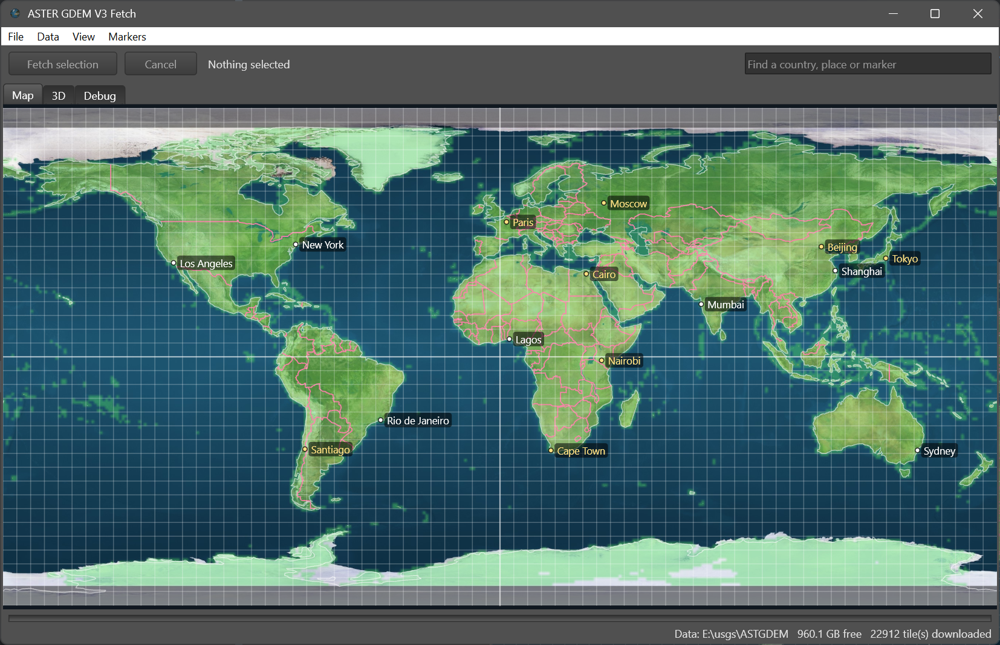

# GDEM

GDEM is a cross-platform Delphi FMX project for working with the
**ASTER Global Digital Elevation Model, version 3** (ASTER GDEM V3, NASA
product code `ASTGTM.003`): worldwide elevation data at 1 arc-second
(about 30 m) resolution.

The first program, **GDEMFetch**, lets you pick an area on a world map and
download the elevation tiles that cover it. Later stages will read and use
those tiles.

The second, **TileMaker**, cuts a large image (such as a 10800 x 5400
world map) into a tile set: square tiles at several levels of detail,
described by a `tileset.json`, for GDEMFetch to draw as you zoom. See
[TileMaker](#tilemaker).



## About the data

ASTER GDEM V3 is published as one-degree tiles, 3601 x 3601 pixels each,
covering latitudes 83°S to 83°N. Each tile is a pair of GeoTIFF files:

| File | Contents |
|------|----------|
| `ASTGTMV003_N50W002_dem.tif` | Elevation in metres, signed 16-bit. `-9999` marks a void, `0` marks sea-level water. |
| `ASTGTMV003_N50W002_num.tif` | Quality and source for each pixel, unsigned 8-bit (number of ASTER scenes used, or which other DEM filled the gap). |

A tile is named after the **south-west corner** of the area it covers, so
`N50W002` covers latitudes 50°N to 51°N and longitudes 2°W to 1°W. The
edge rows and columns overlap the neighbouring tiles.

The world has 360 x 180 = 64,800 possible tiles, but only 22,912 exist:
there are none over open ocean.

The files are LZW-compressed, tiled (256 x 256), little-endian GeoTIFFs
with 8 lower-resolution overview images, in the WGS 84 coordinate system.
The NASA user guide (`ASTGTM_User_Guide_V3.pdf`) has the full details.

## How GDEMFetch gets the data

1. **NASA CMR** (Common Metadata Repository), a public catalogue that
   needs no login, is used to:
   - build the **tile index**, a record of which tiles exist, by listing
     the whole ASTGTM collection; and
   - look up the download links for each tile.
2. Each file is requested from **NASA Earthdata Cloud** using an
   **Earthdata Login bearer token**. NASA answers with a redirect (303) to
   a short-lived CloudFront download link, which is fetched without the
   token: the token is sent only to NASA hosts.

The old LP DAAC Data Pool (`e4ftl01.cr.usgs.gov`) stopped serving ASTER
GDEM on 3 December 2025, so older scripts that use it no longer work.

## Requirements

- **Delphi 13** with FireMonkey (FMX). The build uses RAD Studio's
  `brcc32` and its FMX styles in `Redist\styles\Fmx` (see
  [Themes](#themes)); both come with every RAD Studio install.
- **Gorilla3D 1.5.3**, installed in Delphi, for the 3D tab
  (<https://gorilla3d.de>; reference at <https://peardox.com/G3D/>). It
  draws with OpenGL 4.3 or later on Windows and Linux (on Linux through
  Mesa's GLX under X11, not Wayland) and with Metal on macOS; see
  [The 3D view](#the-3d-view).
- **Skia**, which comes with Delphi 13. GDEMFetch draws with it, on the
  GPU by default (`ConfigureDrawing` in `GDEMDrawing`, called from
  `GDEMFetch.dpr`, and the `SKIA` define the IDE adds when Skia is enabled
  for the project); see [Drawing](#drawing).
- **Neon JSON library**, included as a git submodule in `delphi-neon/`.
  Clone with submodules (see below). The project's search path already
  points at `..\delphi-neon\Source`.
- **FastMM5**, the memory manager on Windows, included as a git submodule
  in `FastMM5/`; see [Memory leaks](#memory-leaks). The projects' search
  path already points at `..\FastMM5`.
- **A free NASA Earthdata Login account**, from
  <https://urs.earthdata.nasa.gov>, and a **bearer token** generated
  there. Tokens last 60 days, so a new one is needed from time to time.
  The token itself records when it expires: Settings shows the date and
  days left as you paste it, the Debug tab logs it at start-up, and a
  dialog warns when fewer than 7 days are left. Fetching is refused once
  it has expired.
- **Internet access** to:
  - `cmr.earthdata.nasa.gov` (tile index and download links)
  - `data.lpdaac.earthdatacloud.nasa.gov` (the files), which redirects
    to `*.cloudfront.net` for the download itself
  - `urs.earthdata.nasa.gov` (Earthdata Login)
- **Platforms:** Windows 32 and 64-bit, Linux 64-bit, and macOS on Intel
  (OSX64) and Apple silicon (OSXARM64). See [Deploying](#deploying) for
  what each needs at run time.
- **Disk space:** about 18 MB per tile on average; the whole world is
  roughly 400 GB in about 46,000 files. The data folder can be anywhere,
  including a removable drive, and can be moved later.

## Getting started

```
git clone --recurse-submodules https://github.com/peardox/GDEM.git
```

If you already cloned without submodules, run
`git submodule update --init`.

1. Open `GDEM.groupproj` in Delphi 13 and build **GDEMFetch**.
2. On first run the Settings dialog opens. Paste your bearer token, choose
   where downloaded tiles should go (or keep the default), and press OK.
3. At the same time the tile index is built from CMR in the background.
   This takes about a dozen requests and needs no token.
4. Select tiles on the map (a single tile is a left click) and press
   **Fetch selection**.
5. To see a downloaded tile and the land round it in 3D, select it and
   press **Show in 3D** (or find a mountain first, such as Everest); see
   [The 3D view](#the-3d-view).

### Using the map

| Action | Control |
|--------|---------|
| Show the selected tile in 3D | Show in 3D, on the toolbar; or switch on Click for 3D and click a downloaded tile; see [The 3D view](#the-3d-view) |
| Select a block of tiles | Left-drag. The size and tile counts update as you drag. A left click selects one tile. To reach beyond the screen, drag towards an edge and the map scrolls that way, faster the nearer the edge, or use the mouse wheel to zoom while still dragging. On Windows the pointer stays inside the map until you let go. |
| Select a whole country | Right-click it (on a Mac trackpad, click with two fingers). Every tile the country touches is selected and tinted, including tiles along its borders and coasts, so neighbouring countries' tiles are included where they share one. Overseas parts count too: France includes French Guiana, the United States includes Alaska and Hawaii. The selection label then gives the country, its tile count, and how many have data and are downloaded, such as `Germany: 68 tile(s), ...`. Fetch selection and Delete Selected Downloads work on just those tiles. Dragging a new selection or clicking replaces it. |
| Add a country to the selection | Shift + right-click it (on a Mac trackpad, Shift + two-finger click). Its tiles join those already selected, whether a country, several countries or a dragged block; a tile in both is selected once. The label names the countries, such as `Germany + France: 146 tile(s), ...`, or the first two and how many more when there are over three (a dragged block is named `Selected area`). With nothing selected it is the same as a right-click. |
| Move the map | Right-drag, middle-drag, or Shift + left-drag. A right click that does not move selects a country instead. The map wraps east to west, so you can keep going past 180°, and selections can cross it (for example around Fiji or the Bering Strait). It stops at the poles, since the world does not wrap north to south. |
| Zoom | Mouse wheel, or the View menu |
| Show or hide tiles that have data (cyan) | View > Show Available Tiles |
| Show or hide downloaded tiles (green) | View > Show Downloaded Tiles |
| Show or hide country borders (pink) and coastlines (white) | View > Show Country Borders, View > Show Coastlines |
| Switch between the high-resolution map and the plain one | View > High-Resolution Map; see [The high-resolution map](#the-high-resolution-map) |
| Find a country, town, city or marker | Type in the box at the right of the toolbar (View > Find..., Ctrl+F); see [Finding places](#finding-places) |
| Add a marker, such as Home or Work | Ctrl + click the map (Cmd + click on a Mac), or Markers > Add Marker at Map Centre..., and give it a name; see [Markers](#markers) |
| Show or hide town and city names, and markers | View > Show Towns and Cities, View > Show Markers |

The status bar shows the position and tile under the pointer, whether
that tile has data, and the country it is in. Progress messages and errors appear in the log on the
**Debug** tab (the file-by-file detail of downloads goes to a
[report file](#how-downloads-work) instead), and serious errors (a failed download or tile index build,
unreadable settings, a missing world map) are also shown in a dialog. The
**3D** tab shows the ground round the tile sent with Show in 3D; see
[The 3D view](#the-3d-view).

### Menus

On Windows the menus are the usual menu bar, and on macOS they are in the
system menu bar at the top of the screen. On Linux they are drawn by FMX
itself, in the program's theme, because the native GTK menu bar FMX would
otherwise use showed only the first letter of each menu and item.

| Menu | Item | Does |
|------|------|------|
| File | Settings... | Bearer token, data folder, how much of the drive to keep free, files copied at once when importing, download speed, theme, drawing (GPU or CPU), and on Windows which graphics processor to use |
| File | Refresh Tile Index | Rebuilds the list of tiles that exist, from CMR |
| Data | Import Existing Tiles... | Copies tiles you already have, from any folder, into the data folder. The originals are not changed. |
| Data | Move Existing Files... | The same, but deletes each original once it is safely in the data folder; see [Moving instead of copying](#moving-instead-of-copying) |
| Data | Rescan Data Folder | Rebuilds the downloaded-tiles bitmap from the files, files any misplaced downloads into place, and removes leftovers and empty folders |
| Data | Delete Selected Downloads... | Deletes the downloaded tiles inside the map selection |
| View | Find... (Ctrl+F) | Puts the cursor in the search box; see [Finding places](#finding-places) |
| View | Zoom In / Zoom Out / Whole World / Zoom to Selection | Map view |
| View | Show Available Tiles / Show Downloaded Tiles | The cyan and green tile tints |
| View | Show Country Borders / Show Coastlines | The borders and coastlines drawn over the map |
| View | High-Resolution Map | Draws the tile set instead of the plain map (greyed out only if the built-in tile set could not be read) |
| View | Show Towns and Cities / Show Markers | The place names and the markers drawn on the map |
| View | Copy Log / Clear Log | Copy the Debug tab's log to the clipboard, or empty it |
| Markers | Add Marker at Map Centre... | Asks for a name and puts a marker in the middle of the map |
| Markers | Edit Markers... | Lists the markers, to go to, rename or delete them |

What the View menu shows is remembered from one run to the next. Out of
the box the tile tints and markers are shown, and the layers that cost the
most to draw without a GPU (country borders, coastlines, the
high-resolution map, and town and city names) are off: tick the ones you
want.

The first time you change **Drawing** (or, on Windows, **Graphics**) in
Settings to something faster, GDEMFetch turns on the View options that
suit it and says which in a dialog:

| Your choice | Turned on |
|-------------|-----------|
| GPU, with Windows' High performance graphics processor | Everything |
| GPU on Windows, with Let Windows decide or Power saving | Borders, coastlines and the high-resolution map |
| GPU on macOS (Metal) | Everything |
| CPU, or Linux (which draws only on the CPU) | Nothing yet: choosing the GPU later still turns options on |

Options already ticked stay as they are, and nothing is ever turned off.
This happens once; after that the View menu is yours. If the map is slow,
turn options off, starting with the most demanding: Show Coastlines, Show
Country Borders, Show Towns and Cities, High-Resolution Map, Show
Available Tiles, Show Downloaded Tiles, Show Markers. The dialog lists
them in that order too.

**Fetch selection** downloads only tiles that have data and are not yet
downloaded. It starts straight away, without asking: the progress dialog
that opens has its own Cancel button. Free space is checked before every
tile, and downloading stops rather than go below the reserve set in
Settings (see [Free space](#free-space)); if the selection looks too big for the space
left, the Debug tab says so at the start. The **Cancel** button stops
whatever job is running.

#### How downloads work

1. Tiles already in the data folder are skipped.
2. NASA CMR is asked where the rest are. For a selection on the map it
   lists every tile in the selected block, 2,000 per request, so even the
   whole world takes only about a dozen requests. Tiles scattered far
   apart are asked for by name instead, 100 per request. Tiles with no
   data (ocean) are left out.
3. The tiles are downloaded, several files at once. A single download
   uses only a small part of a fast connection, so more at once is much
   faster. On a 1 Gbit/s line in the UK, 1 at a time gave about 3 MB/s,
   12 about 26 MB/s and 16 about 56 MB/s (100 tiles, 2.1 GB in 38 s).
   At the Fast setting a 168-tile batch (3.1 GB) ran at 47 MB/s. The
   whole world would take 2 to 2.5 hours at those rates.

**Download speed** in Settings sets how hard GDEMFetch pushes:

| Speed | Starts at | At most | Suits |
|-------|-----------|---------|-------|
| Slow | 1 | 4 | A slow or shared connection |
| Medium (default) | 2 | 8 | Most connections |
| Fast | 4 | 16 | A fast connection |

NASA does not publish a speed limit. When it has had enough it cuts off or
refuses downloads, or answers "Too Many Requests". GDEMFetch copes with
this:

- **Feeling its way.** All downloads in a batch share one limit, which
  works the way TCP shares a network: additive increase, multiplicative
  decrease. It starts at the speed's starting number, and until NASA
  objects each good file allows one more at once, up to the speed's most.
  If downloads are cut off or refused three times within 30 seconds, the
  number at once is halved (down to 1) and everything pauses for 5
  seconds. After that it climbs back carefully: one more after 20 good
  files in a row and a minute without trouble. "Too Many Requests" pauses
  everything for as long as NASA asks. Reaching the most, and every cut or
  raise after a cut, is logged, and the summary says if it had to cut
  back.
- **Resuming.** A file cut off part-way carries on from where it stopped,
  rather than starting again, and such a try is not counted as a failure.
- **Retrying.** Other passing problems are tried three times. A tile that
  still fails is listed on the Debug tab and skipped, and a dialog at the
  end says how many; fetching the same selection again retries them.

A batch only stops early if the bearer token is rejected, free space runs
low, the data folder disappears, or 10 tiles in a row have failed. Failures
with good tiles in between only skip those tiles, so one bad patch in a
long batch does not end it.

**Report file.** Each batch writes everything (every request, redirect
and saved file, with times) to a report file, so the Debug tab stays
short: it shows the report's path, the lookup, the start, any failures or
cut-backs, and the summary. Reports are kept in a `Reports` folder beside
the settings file, named by when the batch started (such as
`download-20261026-231500.log`), and only the newest 50 are kept. The file
is written as the batch goes, so it is complete up to the moment even if
the program stops.

**Staying awake.** While any job runs, GDEMFetch asks the system not to
sleep: `SetThreadExecutionState` on Windows, an `NSProcessInfo` activity on
macOS (which also keeps App Nap from slowing it down when the window is
hidden), and `systemd-inhibit` on Linux where it is installed. The screen
may still turn off. The request ends with the job, or with the program if
it closes or crashes.

Downloading the same tiles again and again in a short time (deleting and
re-fetching them while testing, say) seems to make NASA cut connections
off much sooner. Test on a different area each time.

After a very large amount has been downloaded, NASA may also slow every
download down without refusing any. The day after the whole world had
been fetched (383 GB), downloads from the same account and connection ran
at about 5 MB/s, each file at well under 1 MB/s, anywhere in the world,
with no errors. GDEMFetch cannot speed that up, since nothing is being
refused; it only shows as a low speed in the summary.

The summary at the end gives the size saved, the time taken, the speed
and the most downloads at once reached, for example: `Downloaded 100
tile(s), 2.1 GB, in 38 s at 56 MB/s, up to 16 at a time; ...`.

Whenever data is downloaded (tiles, or the tile index from NASA CMR) a
progress dialog shows the step in progress, overall progress, and progress
through the current file, with a Cancel button. The dialog stays until the
download has actually stopped.

### Borders and coastlines

Country borders and coastlines are drawn over the world map, and the
status bar names the country under the pointer. They come from
[Natural Earth](https://www.naturalearthdata.com), which is in the public
domain, so no permission or credit is needed (credit is given anyway).

- Land borders are drawn as lines, so a border shared by two countries is
  drawn once and coasts are not drawn as borders.
- While much of the world is in view the 1:110m data is drawn; once a
  degree is 8 pixels or more across, the more detailed 1:50m data.
- Country names come from Natural Earth's 1:50m country outlines and use
  its `ADMIN` names ("United Kingdom", "Ivory Coast").
- Borders are shown as they are on the ground, which is Natural Earth's
  default for disputed areas.
- Right-clicking a country selects its tiles: every tile its outline
  passes through (found by walking each edge across the tile grid) and
  every tile whose centre lies inside it (found by filling between the
  outline's crossings of each row). An island smaller than a tile still
  gives its tile.

Towns and cities come from Natural Earth's 1:10m populated places:
7,342 of them, each with its region (state or province), country,
population and, for 634, other names it goes by (Antioch for Antakya,
Koln for Cologne). They are labelled on the map (View > Show Towns and
Cities), more of them the further in you zoom: each is shown from the zoom
level Natural Earth suggests for it, the most important first. A label
goes to the right of its place, or failing that the left, above or below,
whichever is clear of those already drawn; if none is, it is left out. Capitals are
labelled in yellow. Zoomed right out about 25 are named; over Europe at
30 pixels a degree, about 100.

Mountains come from Natural Earth's 1:10m elevation points: 644 named
mountains, spot heights, depressions, plateaus and passes, each with its
height and country, two for a peak on a border (Mont Blanc, France /
Italy). They are not drawn on the map, but the search finds them (see
[Finding places](#finding-places)). Natural Earth picks one well-known
summit for each range, so Everest, K2, Kanchenjunga, Denali, Kilimanjaro,
Mont Blanc and Ben Nevis are there, but some famous neighbours are not
(Lhotse, Makalu, Annapurna).

The data is linked into the program as the `WORLDVECTORS` resource, built
from `maps/world_vectors.bin`, so nothing is deployed. That file is made
from Natural Earth's GeoJSON files by `tools/build_vectors.py`; its
comments say which files it needs and how to run it. It holds five layers
(1:110m and 1:50m borders, 1:110m and 1:50m coastlines, and 1:50m country
outlines with names), about 190,000 points, the towns and cities, and the
mountains, in 1.1 MB. `GDEMVectors.pas` documents the format (version 3;
version 1, from before the towns and cities, and version 2, from before
the mountains, still read).

### The 3D view

The **3D** tab shows the ground round a downloaded tile in 3D: the tile
and its neighbours, about 340 km north to south and as wide east to west,
fine near the camera and coarser further away. Select a single downloaded
tile on the map (a left click, or find a mountain), then press **Show in
3D** on the Map tab's toolbar: the 3D tab opens at once, and the ground
sharpens over the next moments as its pieces are made. The 3D tab keeps
showing that place, whatever is selected on the map afterwards, until
Show in 3D sends another.

With **Click for 3D** switched on (beside Show in 3D), a left click that
selects a single downloaded tile also shows it in 3D, saving the press of
the button; off, as it starts, a click only selects. Only your own clicks
count: finding a mountain selects its tile but stays on the map. The
switch is remembered in `view.json`.

The camera flies. It starts hovering over the middle of the tile, facing
north, 10,000 m above the ground there (set by `flightStartHeight` in
`settings.json`, see below), looking ahead and 20 degrees down. Click the
view, or press Show in 3D, so it has the keyboard; the keys act for as
long as they are held.

| Action | Control |
|--------|---------|
| Go faster, or slower down to a hover (never backwards) | Up and Down. The speed changes faster the faster you already go: from a hover to about 10,800 km/h, the most, in under ten seconds |
| Turn left or right | Left and Right, 45 degrees a second; or left-drag across |
| Climb or descend | Page Up and Page Down, faster the higher you are above the ground (half that height a second, at least 50 m a second); or the mouse wheel, a tenth of the height a notch |
| Tilt the camera up or down | Q and A, 30 degrees a second, from 30 degrees above the level to straight down; or left-drag up and down |
| Stop to a hover | Space |
| Start again over the tile | R, double-click, or Start Again |
| Detail near the camera | **Detail**: Coarse (226 samples across a tile), Medium (451), Fine (901), Very fine (1801) or Full (3601, every sample, the default) |
| Detail further away | **Distance**: Low, Medium (the default) or High |
| Stretch the heights | **Heights**: 1, 2 (the default), 3, 5 or 10 times true scale |

Going below the ground is a **crash**: the flight stops where it hit, a
banner says so (and the Debug tab where), and nothing moves until it
starts again. The flight goes straight on over the globe (a great
circle), and there is no edge: tiles further on are loaded as it goes.

`flightStartHeight` (metres above the ground, default 10000) is not in
the Settings dialog yet. Add or change it in `settings.json` (see
[Where files are kept](#where-files-are-kept)), for example
`"flightStartHeight": 2000`, while GDEMFetch is closed; it is read at
start-up, and written back whenever Settings is closed with OK.

The view draws no more **frames a second** than the display the window
is on refreshes at, and follows the window to another display within a
quarter of a second (Windows and macOS ask the system; Linux does not
say, so 60 is used). The Debug tab says which display and rate.

Instruments over the view:

- **Top left**, the flight's height **above ground** (the ground drawn
  under it), its **altitude** (height above sea level), and the ground's
  own height there. Heights below 10 km are in metres, above in
  kilometres. They are true heights: with heights stretched, the flight
  is drawn as much higher too, so height above ground plus the ground's
  height is always the altitude, and the panel says how much heights are
  stretched. Dashes mean the ground there has not been read yet.
- Under it, the **speed** in km/h (or Hovering) and the camera's tilt,
  then the **frames drawn a second**, from Gorilla3D's own count, and the
  most the display allows.
- **Top right**, a **compass**: the heading is always at the top, under
  the orange mark, and the card turns beneath it, so N points to true
  north on the ground; the heading in degrees is in the middle.

The instruments let the mouse through, so dragging and the wheel work
over them too.

How it works:

- **Patches.** The ground is drawn as square patches of 75 x 75 cells,
  whatever their size: a whole tile far away, down to 75 arc-seconds
  (about 2.3 km) close up, where every sample of the tile is used. A patch
  is split into finer ones when the camera is nearer than 2 times its size
  (1.5 at Low distance detail, 3 at High), so each step away halves the
  detail and the number of triangles stays much the same wherever the
  camera is: a few hundred patches, a few million triangles, over the
  whole area, of which the graphics processor draws only those in view.
  Detail only limits how fine the nearest patches get; far away every
  setting draws the same.
- **Reading.** Each patch reads the coarsest image in the tile's
  `_dem.tif` that is fine enough for it (the file holds the full 3601 x
  3601 and overviews of 1801, 901, 451 and 226 among others), so a
  distant tile costs a small read. A tile is read only when a patch of it
  is wanted.
- **In the background.** Patches are made on worker threads, one per
  processor, those in view first, coarse before fine, near before far;
  the window only turns them into meshes, a few each 15 ms. Until its
  finer patches are all ready a patch stays on show, so the view never
  has holes; it just sharpens.
- **The globe.** Positions are laid out on a sphere, so the ground falls
  away with distance as the Earth's does (0.8 km one tile away), and tiles
  of different latitudes fit together. Moving more than 150 km from where
  the view started measures everything again from there.
- **Joins.** Each patch has a short skirt hanging from its edges, so no
  gap shows where a fine patch meets a coarser one.
- **Around the data.** A tile that exists but is not downloaded is drawn
  flat and grey; sea, where no tile exists, flat and blue.

The surface is coloured by height, from blue water through greens,
yellows and browns to grey rock and white above 4,500 m, and shaded as if
lit from the north-west, so the relief shows at any angle. Voids (-9999)
are filled from the heights around them. Detail, Distance and Heights are
remembered in `view.json`.

When the patches wanted are all made, the Debug tab logs a `3D: settled`
line: the time taken, the patches on show and their triangles, the
patches kept, the tiles (and how many have heights), how many patches the
workers made and how long each took, and how long turning them into
meshes took. A second later a `3D: memory with ...` line gives the memory
in use (see [Memory and graphics in the log](#memory-and-graphics-in-the-log)).

### Finding places

The **Search** box at the right of the Map tab's toolbar finds countries,
towns and cities, mountains, and your [markers](#markers). Matches are
listed under it as you type, best first; Up and Down move through them,
Enter, the arrow button beside the box or a click goes to one, and Escape
closes the list. Clicking into the box empties it, ready for a new search
(as does a click on the box while it shows a place you have gone to);
text you are typing is left alone.

- **A country** is zoomed to fit the window with a margin round it, as
  far as the zoom allows (Vatican City and Jersey are too small to fill
  it, so they are centred at the closest zoom). Far-flung parts are left
  out: France is shown without French Guiana, the United States with
  Alaska but without Hawaii. Countries across the 180 degree meridian,
  such as Russia and Fiji, are shown whole.
- **A town, city or marker** is moved to the middle of the map at the
  zoom you are at, and ringed in yellow. Escape with the list closed, or
  emptying the box, removes the ring.
- **A mountain** is zoomed in on, about 40 km across, ringed in yellow,
  and its tile selected, so Show in 3D shows it straight away. The list
  gives its height and country, such as `Mount Everest, 8,848 m, Nepal`,
  and it is also found by other names (`mckinley` finds Denali). Depressions
  such as Death Valley (-86 m) are found the same way.
- **Spelling mistakes** are forgiven: `lodnon`, `edinbrugh`, `bejing` and
  `kuala lumpar` all find the right place. Accents and punctuation do not
  matter (`sao paulo`, `zurich`, `st johns`, `ndjamena`), and a place is
  also found by its other names. Up to 3 letters must be typed exactly;
  from 4 letters one mistake is allowed, from 7 two and from 11 three. A
  mistake is a wrong, missing, extra or swapped letter.
- **Order:** the whole name, then the start of the name, then the start
  of a later word (`york` finds New York), then anywhere in the name, then
  names with mistakes. Within each, markers come before countries,
  countries before mountains, and mountains before towns and cities; the
  last two in order of importance.
  Places with the same name are told apart by region and country, such as
  `London, Ontario, Canada`.

The search runs on every letter typed, over about 9,200 names, in a few
milliseconds; see `GDEMSearch.pas`.

#### Easter eggs

[additions.md](additions.md) explains every way to add places (markers,
easter eggs, towns and countries), how to find a place's position, and how
names are matched.

The search also finds a few places that are never drawn on the map. They
are kept in `maps/easter_eggs.json`, linked into the program as the
`EASTEREGGS` resource, so to add one, add an entry and rebuild:

```json
{
  "format": 1,
  "places": [
    {
      "name": "Somewhere",
      "lat": 12.3456,
      "lon": -65.4321,
      "sizeKm": 5,
      "aliases": ["Other name", "Another"],
      "note": "Shown on the Debug tab and the status bar when found."
    }
  ]
}
```

`name`, `lat` and `lon` are needed (degrees, south and west negative).
`sizeKm` is how much to show round it when found; leave it out (or 0) to
move there at the current zoom, as for a town. `aliases` are other words
that find it, matched like any other name, with the same forgiveness of
spelling mistakes. `note` is optional. An entry with no name or a
position off the map is left out with a `WARNING:` on the Debug tab; the
others still load.

### Markers

Markers are your own named places, such as Home or Work. **Ctrl + click**
the map (**Cmd + click** on a Mac), or use **Markers > Add Marker at Map
Centre...**, and give it a name. Markers are drawn in orange with their
names over everything else, and the search box finds them.
**Markers > Edit Markers...** lists them, to go to (double-click, or Go
To), rename or delete them. They are kept in `markers.json` in the
settings folder (see [Where files are kept](#where-files-are-kept)),
saved as soon as they change.

### The high-resolution map

The map built into GDEMFetch is 1080 x 540 pixels, 3 per degree, which
turns to blur once you zoom in. So GDEMFetch also has a
[tile set](#tile-sets) made by [TileMaker](#tilemaker) built in, and draws
that over it instead: the 10800 x 5400 world map, 30 pixels per degree, in
four levels.

- **Which level:** the smallest one with at least as many pixels per
  degree as the screen shows, counting the display's own pixels (so a
  scaled or Retina display gets the sharper level sooner). Zoomed right
  out that is the 1350 x 675 level, and from 30 screen pixels a degree
  the full 10800 x 5400.
- **Past full detail:** the map zooms on to 400 screen pixels a degree,
  over 13 times the full image's own detail, so tiles and borders can be
  picked out accurately. Enlarged tiles are drawn with a smooth cubic
  filter rather than as blocks; reduced ones with mipmaps, so they do
  not shimmer.
- **Loading:** tiles are decoded only when they come into view, at
  most 6 a frame so panning stays smooth, and the rest over the next
  frames. Until a tile is ready, the matching part of a coarser tile is
  drawn enlarged in its place. The smallest level (18 tiles) is read at
  start-up and kept, so there is always something to draw. Up to 400
  other tiles (about 80 MB) are kept in memory, the least recently used
  going first.
- **Built in:** the repository's tile set, `maps/tiles`, is packed into
  one file, `maps/tiles.zip`, by `tools/pack_tiles.py`, and linked into
  the program as the `MAPTILES` resource (8.6 MB), so nothing is deployed
  on any platform. The tiles are stored in the zip as they are, not
  compressed again, since they are JPEGs already. After changing
  `maps/tiles` (with TileMaker, say), run
  `python3 tools/pack_tiles.py maps/tiles maps/tiles.zip` from the
  repository root and rebuild.
- The Debug tab says at start-up which tile set was loaded, such as
  `Map: tile set "8081_earthmap10k", 10800 x 5400 in 4 levels of
  225-pixel tiles, built into the program`. With
  **View > High-Resolution Map** unticked, GDEMFetch draws the 1080 x 540
  map.
- Tiles are drawn only when drawing with Skia, which GDEMFetch always
  does.

### Drawing

GDEMFetch draws with Skia, which comes with Delphi, rather than FMX's
own canvases. **File > Settings > Drawing** chooses where:

| Platform | GPU (the default) | CPU |
|----------|-------------------|-----|
| Windows | Vulkan when FMX's `GlobalUseVulkan` is on and the driver supports Vulkan 1.1, otherwise OpenGL; the CPU if neither works | Skia's CPU canvas (`GlobalUseSkiaRasterWhenAvailable`) |
| macOS | Metal (`GlobalUseMetal`) | Skia's CPU canvas |
| Linux | Not offered: Skia only draws on the CPU there | Skia's CPU canvas |

The choice has to be made before the program starts up, so a change takes
effect the next time GDEMFetch starts. The Debug tab says at start-up what
was asked for and which canvas Skia is using, such as `Drawing with Skia:
asked for the GPU, using TVkCanvas`. Choose the CPU if the graphics driver
causes trouble. It also lists each display with its size, position and
scale factor, such as `Display 2: 2560 x 1440 at 1707, 0, scale 1.00`.

On Windows the pointer cannot leave the map while you drag it (to select
or to move the map): it stops at the map's edge until you let go. Where
displays have different scale factors, the pointer's position jumped as
it crossed onto another display, and the map jumped with it. Scrolling at
an edge while selecting is fastest with the pointer right against the
edge.

**File > Settings > Graphics** (Windows only) is Windows' own choice of
graphics processor for GDEMFetch, the same as Windows Settings > System >
Display > Graphics: **Let Windows decide** (the default), **Power
saving** (usually the graphics built into the processor) or **High
performance** (usually the separate graphics card). It matters on
computers with both, such as most gaming laptops. Windows keeps it in the
registry for each program file, under
`HKEY_CURRENT_USER\Software\Microsoft\DirectX\UserGpuPreferences`, and
reads it as the program starts, so:

- choosing it in Settings writes Windows' setting straight away, and it
  takes effect at the next start;
- the choice is also kept in `settings.json`, and at every start GDEMFetch
  makes Windows' setting match it, so a new build in a different folder
  gets the same choice (from its second start). Let Windows decide leaves
  Windows' setting alone, so a choice made in Windows' own Settings
  stands;
- only the `GpuPreference` part of the registry value is changed; other
  Windows settings in it, such as the windowed games optimisation, are
  kept.

The start-up line on the Debug tab includes it, such as `Drawing with
Skia: asked for the GPU, using TVkCanvas; Windows graphics processor: High
performance`. Task Manager's Processes tab, with the GPU engine column
shown, says which processor GDEMFetch is really using.

Measured on Windows while panning and zooming the map: 14 to 21 frames a
second on the CPU, 34 to 125 on the GPU. On the CPU most of each frame
went on filling pixels (stretching the world image and the tile tints
across the window); on the GPU that takes almost no time.

Borders and coastlines are the costly part of the map on the GPU: the
1:50m coastline alone is about 60,000 points. The first time a layer is
drawn it is cut into 10 x 10 degree squares, each made into a Skia path
in degrees, and each frame draws only the squares on screen, moved and
scaled into place. Zoomed in over the British Isles, that is 2 of the
coastline's 355 squares, about 1,500 of its points. Without Skia each
frame works out every point on screen and builds a new path, as GDEMFetch
did before.

These choices were made from timings taken with two View menu items that
have since been removed: one switched the cached paths off, the other
logged frame times. The map can still time itself:
`TWorldMapView.OnPaintStats` reports each drag, pan or run of wheel zooms
(frames, frame rate, average and worst milliseconds, the share spent on
borders and coastlines, and the canvas class), and
`TWorldMapView.UseSkiaPaths` switches the cached paths off. Set either in
code to measure again. On the GPU much of the work happens after the
map's drawing code returns, so the frame rate is the fairer comparison
there.

### Themes

Choose the program's look under **File > Settings > Theme**:

| Theme | Look |
|-------|------|
| Default | FMX's own platform style, with the system's title bars |
| Dark | RAD Studio's Dark style |
| Aqua Graphite, Ruby Graphite, Golden Graphite | RAD Studio's Graphite styles, with a coloured accent |

The theme is applied as soon as Settings closes with OK, and at start-up.
Where the system allows, title bars are coloured to match: the caption and
border on Windows 11, dark or light on Windows 10, and dark or light
appearance on macOS. Linux leaves title bars to the window manager.

The styles are the `.style` files RAD Studio ships in
`Redist\styles\Fmx`. They are kept in the repository's `styles/` folder
and linked into the program as resources, so nothing needs deploying:

- `styles/GDEMThemes.rc` lists them as RCDATA resources named
  `GDEM<Name>Style`.
- `styles/buildstyles.cmd` runs as the project's pre-build event. It
  copies any missing style from RAD Studio's `Redist\styles\Fmx` (styles
  already in the folder are kept, so one can be replaced by hand), then
  compiles `GDEMThemes.rc` into `GDEMThemes.res` with `brcc32`. If anything
  is missing the build stops with an error saying what.
- `GDEMFetch.dpr` links `..\styles\GDEMThemes.res`.

This is the same arrangement as Sprite3D's themes, so the two projects
look and behave alike.

### Memory leaks

On Windows, [FastMM5](https://github.com/pleriche/FastMM5) is the memory
manager of GDEMFetch and TileMaker: it is the first unit in each `.dpr`.
To have leaks reported, remove the `//` before `{$DEFINE REPORT_LEAKS}`
near the top of the `.dpr` (leave it commented out for a release build).
Leaks still allocated when the program closes are then listed in a
message box on every platform, and on Windows FastMM5 also writes every
leaked block and what it holds to `GDEMFetch_MemoryManager_EventLog.txt`
(or `TileMaker_...`) beside the executable. The file is deleted at
start-up, so it only ever holds the last run's leaks; no file means
nothing leaked. On other platforms the system's memory manager is used.

### Memory and graphics in the log

At start-up the Debug tab lists the computer's memory, the program's own
use of it, and each graphics processor with its memory, for example:

```
Memory: 63.4 GB, 43.7 GB available
This program: 251 MB in memory (peak 251 MB), 10 MB allocated
GPU 1: NVIDIA GeForce RTX 5090 Laptop GPU, 23.6 GB own memory, 47.4 GB shared; this program may use 22.8 GB, this program uses 58 MB
GPU 2: Intel(R) Graphics, 128 MB own memory, 47.4 GB shared; this program may use 46.7 GB, this program uses 0 MB
```

(A Windows laptop with two graphics processors. "Allocated" is only
what the program's own code holds; the rest of its memory is code,
drivers and images held by Skia and the graphics drivers.)

A second after the 3D view has made all the patches it wants, a `3D:
memory with ...` line gives what is in use then, so the cost of a detail
setting can be read off. What is known depends on the
system:

- **Windows:** everything. "May use" is the budget Windows gives the
  program on that graphics processor (Windows 10 and later), "uses" the
  program's own use of it, and "allocated" FastMM5's count of the bytes
  the program holds.
- **macOS:** memory from the kernel; each Metal device with its name,
  whether it shares memory with the processor (Apple silicon), the working
  set Metal recommends at most ("may use") and what the program has
  allocated on it.
- **Linux:** memory from `/proc`; graphics cards from `/sys/class/drm`.
  AMD cards give their memory and how much all programs use; NVIDIA cards
  give their name and memory if `nvidia-smi` is installed; Intel graphics
  share the system memory. There is no per-program figure for the
  graphics processor.

## Deploying

The world map, its high-resolution tile set, and its borders and
coastlines are linked into the executable as resources (see [The
high-resolution map](#the-high-resolution-map)), which Delphi does on
Windows, macOS and Linux alike, and everything else (settings, the tile
index, the data folder) is created at run time. The only file deployed
beside the program is **Skia's library** on Windows and Linux: `sk4d.dll`
(from RAD Studio's `bin` or `bin64`) and `libsk4d.so` (from `binlinux64`).
The IDE added Deployment entries for them when Skia was enabled for the
project; leave those ticked. On macOS Skia is linked into the program. The
default Deployment Manager entries are all that is needed.

The IDE adds files that are part of the project, such as the map image,
`maps/world_vectors.bin`, `maps/tiles.zip` and `styles/buildstyles.cmd`, to the deployment
on its own. These are disabled in `GDEMFetch.dproj` for every platform:
the map and vectors are already inside the program, the script only runs
at build time, and on macOS
anything in the app's `Resources/StartUp` folder is copied out to the
user's folders by `System.StartUpCopy`. If the Deployment Manager ever
shows them ticked again, untick them.

**Windows:** the executable and `sk4d.dll` beside it. Its icon, `GDEMFetch/gdem.ico`
(16 to 256 pixels), is compiled into it, set as the project's main icon
for both Windows targets.

**macOS:** deployed as an app bundle through PAServer.
- The bundle identifier is `com.peardox.GDEMFetch`.
- `Info.plist` carries only the privacy descriptions GDEMFetch can need:
  the Documents, Desktop and Downloads folders, removable drives and
  network drives. macOS shows these the first time the program uses such
  a location, for example when the data folder is on an external drive.
  The IDE's default descriptions for location, camera, microphone,
  Bluetooth and so on were removed because the program uses none of them.
  If the IDE puts them back after a platform change, remove them again
  under Project > Options > Application > Version Info.
- To run it on Macs other than your own it must be signed and notarised.

**Linux:** the executable and `libsk4d.so` beside it. These must also be
installed on the target machine, not deployed with the program. Desktop distributions usually have them already.

| Needed for | Package (Debian / Ubuntu) | Package (Fedora) |
|------------|---------------------------|------------------|
| Downloads (`THTTPClient` uses libcurl) | `libcurl4` | `libcurl` |
| The FMX user interface | `libgtk-3-0` | `gtk3` |
| Opening web links from Settings (`xdg-open`) | `xdg-utils` | `xdg-utils` |

Removable drives are normally mounted under `/media/<user>/` or
`/run/media/<user>/`; choose the data folder there in Settings.

## Where files are kept

| What | Where |
|------|-------|
| Settings (`settings.json`, holds the bearer token) | Windows: `%APPDATA%\GDEM`<br>macOS: `~/Library/Application Support/GDEM`<br>Linux: `$XDG_CONFIG_HOME/GDEM` or `~/.config/GDEM`<br>Android and iOS: `GDEM` in the app's documents folder |
| Tile index (`tileindex.bin`) | Same folder as the settings |
| Download reports (`Reports/download-*.log`) | Same folder as the settings |
| Markers (`markers.json`) | Same folder as the settings |
| What the View menu shows, the 3D tab's Detail, Distance and Heights, and Click for 3D (`view.json`) | Same folder as the settings, kept apart from `settings.json` so that saving it never makes a first run look set up |
| Windows' graphics processor choice | Windows only: the registry value named after the program's path in `HKEY_CURRENT_USER\Software\Microsoft\DirectX\UserGpuPreferences`; see [Drawing](#drawing) |
| Downloaded tiles | The **data folder**, chosen in File > Settings. Default: `ASTGTM` in your documents folder. |

On macOS and Linux `settings.json` is readable by its owner only, because
it contains a credential.

`tileindex.bin` is 14 bytes of header followed by 8,100 bytes: one bit per
tile. The layout is documented in `GDEMTileIndex.pas`. Use **File >
Refresh Tile Index** to rebuild it.

### The data folder

Tiles are grouped into folders by 10 x 10 degree block, named after the
block's south-west corner the same way tiles are:

```
<data folder>/
  gdem-store.json       marks this as a GDEM data folder
  downloaded.bin        bitmap of fully downloaded tiles
  N50/
    W010/
      ASTGTMV003_N50W002_dem.tif
      ASTGTMV003_N50W002_num.tif
      ...
```

Each block folder holds at most 200 files, and the whole world needs about
600 of them. Neighbouring tiles share a folder, so a selection on the map
touches only a few. Folders are created as needed and removed when they
become empty.

The folder describes itself, so it can be moved or copied freely:

- **Changing folder in Settings:** if the old folder holds data, you are
  asked whether to move it. Moving runs in the background, can be
  cancelled, and picks up where it left off if you choose the same folder
  again.
- **Moving or copying it yourself** (for example to another drive): point
  Settings at the new location, then use **Data > Rescan Data Folder** if
  the map does not show your downloads.
- **Removable drives:** once a folder has been used, if it is missing the
  program asks you to connect the drive and press Retry, at start-up and
  before downloading. The status bar shows whether the folder is
  connected and how much space is free, and is refreshed every minute.
- **Downloads from older versions** of GDEMFetch were saved flat in
  `Documents/ASTGTM`. The first rescan of that folder files them into
  blocks.

### Free space

**File > Settings** has *Leave at least ... % free drive space*: the share
of the data folder's drive that downloads, imports and moves always leave
free. It is a percentage of the drive's size, so it suits any drive: the
default, **10%**, is about 100 GB on a 1 TB drive and 400 GB on a 4 TB one.
The dialog shows what the number comes to on the chosen folder's drive.

SSDs in particular need spare space: nearly full, they slow down and wear
faster. The setting can go from 1% to 50%. It cannot be 0, so the drive is
never filled completely; below about 10% is fine for a hard disk but not
kind to an SSD. A batch stops before going below it, the status bar shows
`LOW ON SPACE` once the drive is under it, and moving the data folder
checks the destination drive against its own share. If a drive's size
cannot be found out, 2 GB is kept free instead.

Settings saved by older versions held a fixed size in megabytes; that is
ignored, and the setting starts at 10%.

### Importing tiles you already have

If you already have ASTER GDEM V3 `.tif` files, for example from another
download tool that puts everything in one folder, use **Data > Import
Existing Tiles...** and choose that folder.

- Every `ASTGTMV003_<tile>_dem.tif` and `_num.tif` file in the folder, and
  in any folders inside it, is **copied** into the data folder's blocks.
  The source is only read; nothing in it is changed, moved or deleted.
- Other files are ignored, and so are files that do not start like a TIFF.
- The space needed is worked out first, and the import does not start if
  it would leave less than the reserve set in Settings. Space is checked
  again before every file.
- Each file is copied under a temporary name and size-checked before it
  takes its real name, so a cancelled import leaves no partial tiles.
  Files the data folder already has are skipped, so an import can be
  cancelled and run again to finish.
- Files are copied one at a time by default. On SSDs, choosing a higher
  number (2, 4, 6, 8, 10, 12 or 16) for **Files copied at once when
  importing** in Settings can be several times faster, because the time
  each file takes to open, flush, check and rename then overlaps. Keep it at 1 for a spinning hard disk, where
  several files at once make the heads jump between them.
- A progress dialog shows the file being copied, how many files have been
  dealt with, and how much has been copied out of the total, with the
  copying speed and an estimate of the time left. Its Cancel button stops
  the import after the file in progress.
- A file that cannot be copied is tried three times, which rides out
  brief problems such as a virus scanner still holding the new file or the
  drive resetting for a moment. If it still fails it is listed on the
  Debug tab and skipped, and the import carries on; a dialog at the end
  says how many were skipped, and running the import again retries them.
  The import only stops early if free space runs low, the data folder
  disappears (a removable drive unplugged), or 20 files have failed.
- When it finishes (or is cancelled) the data folder is rescanned and the
  map shows the imported tiles in green.
- External SSDs often slow down late in a long import: their fast write
  cache fills, or the enclosure gets hot and throttles. That is the drive,
  not the program.
- The source folder must not be inside the data folder, or contain it.

#### Moving instead of copying

**Data > Move Existing Files...** does everything an import does, but
deletes the originals, for moving an old download into the data folder's
layout:

- Each original is deleted only once its copy is in the data folder,
  complete (size-checked) and under its real name. Originals the data
  folder already has, at the same size, are deleted too.
- Files that are not ASTER GDEM tile files, and any that cannot be copied,
  are left where they are. Folders inside the chosen folder that end up
  empty are removed; the chosen folder itself is kept.
- When the old files are on the same drive as the data folder, no extra
  space is needed overall (each file's space is freed as the next is
  used), so the import's up-front check for room for a full copy is
  skipped. The check before every file still keeps the reserve free.
- It asks first, saying that the originals will be deleted. Like an
  import, it can be cancelled and run again; files already moved are gone
  from the source, so the next run carries on with the rest.
- The Debug tab's summary says how many originals were deleted, and lists
  any that were safely copied but could not be deleted (read-only files,
  say).

## TileMaker

TileMaker (`TileMaker/`, in the project group) turns one large image into
a **tile set**: the image at several levels of detail, each cut into
square tiles, so a program can draw just the tiles on screen, at the
detail the zoom needs.

**File > Open...** reads an image (JPEG, PNG, WebP, BMP or GIF; Skia
decodes it). The right-hand panel shows:

- its size and the prime factors of its width and height, which decide
  how it can be divided;
- the **levels**: the image itself, then each half the size of the last,
  for as long as both sides stay whole and until a level is no wider than
  *Smallest level width at most* (2048 by default, about a screen
  across);
- the **tile sizes** that cut every level exactly: the divisors of the
  smallest level's width and height in common. TileMaker offers those from
  16 to 2048 pixels and picks the one nearest 256;
- the tiles each level needs, and in all.

The preview shows the image with any level's tile grid over it.

For the 10800 x 5400 world map, 10800 = 2^4 x 3^3 x 5^2 and 5400 =
2^3 x 3^3 x 5^2. The three shared 2s allow three halvings, and the
smallest level, 1350 x 675 (675 = 3^3 x 5^2), is about the size of a
window showing the whole world. Square tiles must divide 675, so they are
odd: 135, 225 or 675. 225 is used:

| Level | Size | Pixels per degree | Tile covers | Tiles |
|-------|------|-------------------|-------------|-------|
| 0 | 10800 x 5400 | 30 | 7.5 degrees | 48 x 24 = 1152 |
| 1 | 5400 x 2700 | 15 | 15 degrees | 24 x 12 = 288 |
| 2 | 2700 x 1350 | 7.5 | 30 degrees | 12 x 6 = 72 |
| 3 | 1350 x 675 | 3.75 | 60 degrees | 6 x 3 = 18 |

Square tiles, rather than 2:1 rectangles, because in this projection a
square tile is a square patch of the world, and a zoomed-in view is
rarely 2:1. Tile edges at 7.5 degrees cannot also fall on whole degrees
(that needs a multiple of 30 pixels, and 675 is odd), which does not
matter for imagery.

**Options:** tile size, smallest level width, tile format (JPEG, the
default, at quality 90; WebP; or PNG) and quality, and *Whole-world map
(wraps east to west)*. With that ticked the tile set says it covers 180
west to 180 east and 90 north to 90 south, in the equirectangular
projection, and resampling treats the left and right edges as
neighbours; untick it for an image that is not a world map.

**Resampling.** Every smaller level is made straight from the full image,
not from the level above, with a **Lanczos-3** filter widened to the
reduction (12 source pixels across for a halving, 48 for an eighth) and in
**linear light** (sRGB values are turned into light, filtered and turned
back, so fine bright detail is not darkened). Alpha is filtered
premultiplied. Off the top and bottom the edge row is repeated. This is
chosen for quality, not speed; see `common/GDEMResample.pas`. Level 0 is
the image as it is.

**File > Save As...** asks for a name and makes a folder of that name (an
extension typed is dropped). It must be new or empty; a folder holding an
earlier tile set may be replaced, after asking, and anything else is left
alone. The work runs in the background with a progress bar and Cancel.

### Tile sets

```
<tile set>/
  tileset.json
  10800x5400/          level 0
    r000_c000.jpg      top-left tile
    r000_c001.jpg      the next one east
    ...
  5400x2700/           level 1
  2700x1350/
  1350x675/
```

Each level's folder is named after its size; tiles are named `r` and the
row, `_c` and the column, three digits each, from 0 at the top left.
`tileset.json` describes it:

```json
{
  "format": 1,
  "name": "8081_earthmap10k",
  "source": "8081_earthmap10k.jpg",
  "sourceWidth": 10800,
  "sourceHeight": 5400,
  "tileSize": 225,
  "imageFormat": "jpg",
  "quality": 90,
  "resampling": "lanczos3, linear light",
  "projection": "equirectangular",
  "bounds": { "west": -180, "north": 90, "east": 180, "south": -90 },
  "levels": [
    { "width": 10800, "height": 5400, "columns": 48, "rows": 24, "folder": "10800x5400" },
    ...
  ],
  "generator": "TileMaker",
  "created": "2026-10-27T15:00:00.000Z"
}
```

`tileset.json` is written last, so a folder without it is an unfinished
tile set (an interrupted or cancelled save). `common/GDEMTileSet.pas`
reads and writes it, and checks that every level is whole tiles and half
the size of the one before.

## Reading the tiles

`common/GDEMGeoTiff.pas` reads the downloaded GeoTIFF files in pure
Pascal, so no native library (such as libtiff) has to be deployed.
`TGeoTiff` opens a file, lists its images (the full 3601 x 3601 image and
its eight overviews, 1801 down to 45 pixels across) and decodes any of
them into an array: signed 16-bit heights from a `_dem.tif`
(`ReadInt16`), unsigned 8-bit values from a `_num.tif` (`ReadUInt8`).
`Georeference` says where each image lies: for a tile such as
`N50W002`, the first pixel's centre is exactly 2 degrees west, 51 north,
and the last 1 west, 50 north.

It reads classic TIFF in either byte order, tiled or in strips, with 8- or
16-bit samples, uncompressed or compressed with LZW (as ASTER GDEM is),
Deflate or PackBits, with or without the horizontal predictor, which
covers most single-band GeoTIFFs GDAL writes. It was checked against
libtiff on two real ASTER tiles, every pixel of all nine images of each,
and on test files of every other kind it reads.

`tools/GeoTiffCheck` is a console program that decodes files with it and
prints, for each image, the size, the lowest and highest values, how many
are -9999 (a void), an FNV-1a checksum of the decoded samples and the time
taken. Open `GeoTiffCheck.dpr` in Delphi (the IDE makes its project file)
and run it with tile files as arguments.

## Repository layout

| Path | Contents |
|------|----------|
| `GDEM.groupproj` | Project group |
| `GDEMFetch/` | The GDEMFetch application: the project files, with its units in `lib/` and `ui/` (see [GDEMFetch units](#gdemfetch-units)) |
| `TileMaker/` | The TileMaker application, laid out the same way (see [TileMaker units](#tilemaker-units)) |
| `common/` | Units shared by the programs: no FMX, and nothing from any program's folders (see [Common units](#common-units)) |
| `styles/` | FMX styles for the themes, with the resource script and the pre-build script that builds them; see [Themes](#themes) |
| `maps/` | World map images and vectors. `world_1080x540.jpg` and `world_vectors.bin` (borders, coastlines, countries, and towns and cities) are linked into GDEMFetch as resources. `8081_earthmap10k.jpg` (10800 x 5400) is kept here locally but is excluded by `maps/.gitignore`, so it is not in the repository; `maps/tiles/` is the tile set TileMaker made from it (225-pixel JPEG tiles, four levels, 1530 tiles, 8.4 MB), which is, and `maps/tiles.zip` the same packed into one file by `tools/pack_tiles.py`, linked into GDEMFetch as a resource. |
| `delphi-neon/` | Neon JSON library (git submodule) |
| `FastMM5/` | FastMM5 memory manager, used on Windows (git submodule); see [Memory leaks](#memory-leaks) |
| `tools/pasdoc_check.py` | Checks the units of `GDEMFetch/`, `TileMaker/` and `common/` follow the PasDoc and layout rules; see [Notes for Claude](#notes-for-claude) |
| `tools/build_vectors.py` | Builds `maps/world_vectors.bin` from Natural Earth; see [Borders and coastlines](#borders-and-coastlines) |
| `tools/pack_tiles.py` | Packs `maps/tiles` into `maps/tiles.zip`; see [The high-resolution map](#the-high-resolution-map) |
| `tools/GeoTiffCheck/` | A console program that decodes GeoTIFF files with `GDEMGeoTiff` and prints each image's size, range, voids and a checksum, to check the reader; see [Reading the tiles](#reading-the-tiles) |
| `additions.md` | How to add places the search finds: markers, easter eggs, towns and countries |
| `LICENSE` | GDEM's licence: MIT, for its own source code |
| `CREDITS.md` | The libraries, data and images GDEM uses, with their licences and what each asks |
| `CLAUDE.md` | Handover notes: the project's current state, test results and lessons learned, for picking the work up in a new conversation |
| `docs/` | Ignored for development |
| `models/` | Ignored for development |

### GDEMFetch units

The project files (`GDEMFetch.dpr`, `GDEMFetch.dproj`, the icon and the
macOS templates) are in `GDEMFetch/`; the units are in two folders inside
it:

- **`lib/`**: everything that does the work and could serve another
  program: tiles, NASA, downloads, the data folder, settings. These units
  never use FMX or anything in `ui/`; `tools/pasdoc_check.py` reports any
  that do.
- **`ui/`**: everything to do with the user interface: the forms, the
  map, themes and drawing. These use `lib/` freely.

**lib/**

| Unit | Purpose |
|------|---------|
| `GDEMTiles` | Tile names and `TTileRect`, a block of tiles |
| `GDEMTileIndex` | `TTileIndex` bitmap of which tiles exist, and its CMR builder |
| `GDEMCMR` | Neon models for CMR search results; no networking |
| `GDEMDownloader` | Finds and downloads tiles: CMR lookups, single downloads, `TDownloadThrottle` |
| `GDEMDownloadBatch` | `TDownloadBatch`, a whole batch of downloads: lookup, parallel workers, retries and summary, reporting through events |
| `GDEMReport` | `TDownloadReport`, the report file for each batch of downloads; `HideURLQueries` |
| `GDEMStore` | The data folder: block layout, downloaded-tiles bitmap, importing, rescanning, moving, deleting, free space; `FormatByteSize` and `FormatDuration` |
| `GDEMVectors` | `TWorldVectors`: country borders, coastlines and country names, country extents for zooming, and towns and cities (`TGeoPlace`) |
| `GDEMSearch` | `TPlaceSearch`: finds countries, towns and cities and markers by name, forgiving spelling mistakes |
| `GDEMMarkers` | `TMarkerList`: the user's markers, kept in `markers.json` with Neon |
| `GDEMViewOptions` | `TViewOptions`: what the View menu shows, kept in `view.json` with Neon |
| `GDEMEasterEggs` | Reads the hidden places the search finds, from the `EASTEREGGS` resource (`maps/easter_eggs.json`) with Neon |
| `GDEMSettings` | Loads and saves `settings.json` with Neon |
| `GDEMCancel` | `TCancelToken`, shared by the Cancel button and background jobs |
| `GDEMAwake` | `TKeepAwake`, which keeps the computer from sleeping while a job runs |
| `GDEMBrowser` | Opens web links in the default browser on each platform |
| `GDEMGpuPreference` | Reads and sets Windows' graphics processor preference for the program (ported from Sprite3D's `GpuPreference`); does nothing on other platforms |
| `GDEMMapTiles` | `OpenBuiltInMapTiles`, the tile set linked into the program |
| `GDEMTerrain` | The pieces of the 3D surface: `TTerrainFrame` (positions on a sphere, from a point, and back to latitude, longitude and height; east and north at any place), `TTerrainTile` (a tile's heights, each overview read when first needed), `BuildTerrainPatch` (one patch's positions, normals, shaded colours and skirt) and `TerrainPatchIndices` (the triangles every patch shares) |
| `GDEMTerrainLod` | `TTerrainLod`: the trees of patches for the tiles round the camera, which patches to show from where it is, and making them on worker threads |
| `GDEMFlight` | `TFlight`: the 3D view's flight (latitude, longitude, true altitude, heading, speed, camera tilt), moved along a great circle by the controls held, and the crash test |

**ui/**

| Unit | Purpose |
|------|---------|
| `MainForm` | Main window: menus over three tabs (Map, with its toolbar and the search box; 3D, with its own; Debug), with progress and status bars; runs the jobs and shows their progress |
| `SettingsForm` | Modal settings dialog |
| `ProgressForm` | Modal progress dialog shown while data is downloaded or imported |
| `MarkersForm` | Modal dialog listing the markers, to go to, rename or delete them |
| `GDEMWorldMap` | `TWorldMapView`, the zoomable map with tile selection, borders and coastlines, the high-resolution map's tiles (`MapTiles`), town and city names, markers, and `ZoomToArea` and `CentreOn` for the search |
| `GDEMTerrainHud` | The instruments over the 3D view: `TTerrainAltimeter` (height above ground, altitude, the ground's height), `TTerrainSpeedPanel`, `TTerrainFrameRate`, `TTerrainCompass` and `TTerrainBanner` (a crash), painted controls that let the mouse through |
| `GDEMDisplays` | Which display a form is on and its refresh rate (from Sprite3D's `DisplayData`), so the 3D view draws no faster than the display shows |
| `GDEMTerrainView` | `TTerrainView`, the 3D tab's Gorilla3D view of the ground round a tile, flown over with the keyboard and mouse; turns patches into meshes |
| `GDEMDrawing` | `ConfigureDrawing`, called from the `.dpr` before `Application.Initialize`, which tells Skia to draw on the GPU or the CPU and applies the Windows graphics processor choice |
| `GDEMThemes` | The themes, and `ApplyTheme` |
| `GDEMStyles` | Switches FMX styles at run time (ported from Sprite3D) |
| `GDEMTitleBar` | Colours title bars to match the style (ported from Sprite3D) |

### TileMaker units

| Unit | Purpose |
|------|---------|
| `ui/TileMakerForm` | Main window: File > Open and Save As, the plan, options, preview with tile grid, log and progress |
| `lib/GDEMTiler` | Reads an image with Skia (`LoadSourceImage`), plans a tile set (`PlanTileSet`) and writes it (`WriteTileSet`); no FMX |

### Common units

`common/` holds units more than one program uses. Like `lib/`, they never
use FMX or anything in a program's folders, and `tools/pasdoc_check.py`
reports any that do. Each program's `.dpr` lists them with
`in '..\common\Name.pas'`.

| Unit | Purpose |
|------|---------|
| `GDEMFactors` | Prime factors, greatest common divisor, divisors, and planning levels of detail and tile sizes from an image's size |
| `GDEMResample` | `TRGBA8Image`, and `ReduceImage`: shrinking by a whole factor with Lanczos-3 in linear light |
| `GDEMTileSet` | `TTileSet`, a tile set's description, read and written as `tileset.json` with Neon |
| `GDEMTileCache` | `TTileCache`: a tile set's tiles, from its folder or packed in a zip, decoded with Skia when first needed and kept, the least recently used dropped first; a level can be kept for good (used by GDEMFetch) |
| `GDEMGeoTiff` | `TGeoTiff`: reads GeoTIFF files such as the downloaded tiles, in pure Pascal; see [Reading the tiles](#reading-the-tiles) |
| `GDEMSystemInfo` | The system memory (`ReadMemoryInfo`), the program's use of it (`ReadProgramMemory`, with the memory manager's count through `ProgramHeapReader`), and each graphics processor with its memory (`ReadGpuInfo`), on Windows, macOS and Linux; `DescribeSystem` and `DescribeMemoryUse` for the log; see [Memory and graphics in the log](#memory-and-graphics-in-the-log) |

The world map image `maps/world_1080x540.jpg` is linked into GDEMFetch as
the `WORLDMAP` RCDATA resource, `maps/easter_eggs.json` as `EASTEREGGS`,
`maps/tiles.zip` as `MAPTILES`,
and `maps/world_vectors.bin` as
`WORLDVECTORS`, so nothing needs deploying beside the program. The image
is an equirectangular projection: 3 pixels per degree, longitude -180 at
the left and latitude 90 at the top.

## Roadmap

- **Defaults from the hardware:** use the memory and GPU figures to
  choose CPU or GPU drawing (and perhaps the View layers and 3D detail)
  on a first run.
- **3D view:** the high-resolution map laid over the surface; a camera
  that flies over the ground; fog in the distance.
- **More mountains:** a checked list of famous peaks Natural Earth leaves
  out, such as Lhotse, Makalu and Annapurna.
- **Finer borders:** Natural Earth's 1:10m borders and coastlines would
  suit the [high-resolution map](#the-high-resolution-map) when zoomed in;
  they can be added as more layers in `tools/build_vectors.py`.

## Licence

GDEM's own source code is under the [MIT licence](LICENSE). The
libraries, data and images it uses keep their own licences, listed with
what each asks in [CREDITS.md](CREDITS.md). Two of them matter when giving
a build to anyone else: FastMM5 is used under the GPL v3 until its
commercial licence is bought, so Windows builds of GDEMFetch should not be
given out until then; and permission for the world map image behind the
high-resolution map is still to be confirmed.

## Notes for Claude

These are the working rules for this project. Read this whole README
before starting work, then `CLAUDE.md`, which records where the work has
got to, what has been tested and what was learned along the way.

### Delivering work

- **Never supply patches or diffs.** Supply whole files.
- When supplying several files, put them in a **zip containing only the
  new and changed files**, with paths relative to the repository root, so
  it can be unzipped straight over the working copy.
- The owner works from a local copy and pushes when happy with the
  results. **Do not mention that changes are uncommitted or unpushed.**
- **Do not mention being unable to compile.** That is already known.
- The GitHub repository may be behind the owner's working copy. Build on
  the files most recently supplied in the conversation.
- Update this README when features or requirements change, and include it
  in the zip when it does.
- When adding a library, data set or image, add it to `CREDITS.md` with its
  licence and what it asks, and check it can sit with GDEM's MIT licence
  and the others there.

### Repository

- Honour `.gitignore`, `.gitmodules` and the other `.git*` files.
- Ignore the `docs/` and `models/` folders.
- Neon and FastMM5 are submodules; never copy their sources into the
  project, and never change them.

### Code

- **Delphi 13, FMX, cross-platform** wherever possible: Windows, macOS,
  Linux, and Android and iOS where practical.
  - No Windows-only units or calls without `{$IF}` alternatives for the
    other platforms.
  - Prefer pure Pascal to native libraries that would need deploying.
    Skia is the exception: it comes with Delphi, and its library is
    deployed by the entries the IDE adds.
- **Drawing goes through Skia** where it matters for speed. Large,
  unchanging shapes (the borders and coastlines) are built into Skia
  objects once and drawn with a matrix each frame, through the Skia
  canvas FMX draws on (`TSkCanvasCustom(Canvas).Canvas`, which already
  holds the control's position and clipping). Cut them into regions with
  bounds and draw only the regions on screen: drawing a whole-world path
  every frame was slower when zoomed in than building just the visible
  part. Keep a fallback through FMX's own canvas for when the canvas is
  not a Skia one, and wrap Skia code in `{$IFDEF SKIA}`.
- Anything Skia or FMX must know before start-up (the GPU or CPU choice)
  goes in `ConfigureDrawing`, which reads the settings file itself, since
  the main window has not loaded the settings yet.
- **JSON uses Neon**, not hand-written `System.JSON` code. Map keys
  explicitly with `[NeonProperty('...')]` where they differ from the
  Delphi names, and turn on `RaiseExceptions` when reading.
- **Document all code in PasDoc format** (<https://pasdoc.github.io/>):
  every unit, type, field (private ones included), method, property and
  constant, using `@abstract`, `@param`, `@returns`, `@raises` and
  `@link`.
  - The comment goes immediately before the item. Attributes such as
    `[NeonProperty('...')]` may sit between them; PasDoc skips them.
  - `@link` only to items declared in this project. Inherited or library
    items (`ShowModal`, `TThread`) are written with `@code` instead, as
    PasDoc cannot resolve them.
  - Things declared only in an implementation section are not in the
    generated docs, but are documented anyway.
  - Before delivering, run `python3 tools/pasdoc_check.py` from the
    repository root. It reads `GDEMFetch/`, `TileMaker/` and `common/`
    (with their `lib/` and `ui/`), and reports undocumented interface
    items, `@link` targets that do not exist, unbalanced `@tag(...)`
    brackets, class fields declared after a method or property (which
    Delphi rejects), a type declared in a `const` or `var` section (a
    `type` missing after a block of constants), and `lib/` or `common/` units that use FMX or a `ui/`
    unit. It prints `No problems found` when all is well.
- **Source files are ASCII only.** Delphi reads files without a byte
  order mark as ANSI, so write characters such as the degree sign as
  character codes (`#$00B0`).
- Keep the existing UTF-8 byte order mark on `.dproj` files.
- Anything the program needs at run time is linked in as a resource
  (an `RcItem` in the `.dproj`, read with `TResourceStream`), so nothing
  has to be deployed beside it. If a file ever cannot be a resource, add
  Deployment entries for every platform and say so in
  [Deploying](#deploying).
- When adding a file to the project (an `RcItem`, or a `None` item such as
  a script), disable its entry for every platform in the `.dproj`'s
  Deployment section (`<Enabled>false</Enabled>`), as is done for the map
  and `buildstyles.cmd`; the IDE otherwise deploys it.
- On Linux, a form's `TMainMenu` is replaced by an FMX `TMenuBar`
  (`TfrmMain.UseFmxMenuBar`): the native GTK menu bar showed only the
  first letter of each item. Copy the items onto the bar, free the
  original items one by one (so FMX rebuilds the GTK bar empty; freeing
  the `TMainMenu` with items in it leaves the GTK bar showing), free the
  `TMainMenu`, then give each copy its original's name, which points the
  form's field at it. Do not move the original items: FMX has already
  given them GTK widgets, which freeing the `TMainMenu` destroys, and the
  next change to a moved item crashes in GTK. A new form with a menu needs
  the same.
- On macOS, every privacy-sensitive location the program touches needs a
  usage description in the Version Info keys; keep them accurate.
- Naming: fields `F`, parameters `A`, locals `L`; non-visual units
  `GDEM*.pas`; forms `*Form.pas`.
- **Units shared by programs go in `common/`** at the repository root:
  no FMX, nothing from a program's folders. A program's own units go in
  its `lib/` or `ui/` as below.
- **Units go in `lib/` or `ui/`.** Anything that does the work goes in
  `lib/`, never using FMX or a `ui/` unit, so later programs can reuse it;
  `tools/pasdoc_check.py` reports a `lib/` unit that breaks this. Forms,
  controls, themes and anything else that needs FMX go in `ui/`. Keep
  work out of forms: a form starts a job and shows it, as `MainForm` does
  with `TDownloadBatch`, whose events it points at its progress and log
  methods. A unit that is mostly one but needs a little of the other goes
  where its dependencies put it (`GDEMDrawing` reads settings, but must
  set Skia's FMX switches, so it is in `ui/`). Add a new unit to both the
  `.dpr` (`in 'lib\Name.pas'`) and the `.dproj`.
- Long-running work runs on a `TTask`. Controls are only touched through
  `TThread.Queue`. Long-running classes can be cancelled from another
  thread, and the main window waits for them before closing.
- Report serious failures with `TfrmMain.ReportError`, which logs them and
  shows a modal error dialog. Cancelling is not an error. Problems that are
  recovered from automatically are logged as `WARNING:` only.
- Anything that downloads external data shows the modal progress dialog:
  pass a title to `RunJob` (its last parameter), or use `BeginProgress`,
  `ShowProgressModal` and `EndProgress` directly, and send updates with
  `ProgressStatus`, `ProgressOverall` and `ProgressItem`, which are safe to
  call from any thread. Importing uses the same dialog, because it can run
  for hours. Other local work (rescanning, moving, deleting) shows progress
  on the main window's bar instead.
- Anything at start-up that may need the user goes in
  `TfrmMain.RunStartup`, in order, so one dialog never opens on top of
  another.
- Forms must not have their own StyleBook, so the theme set through
  `TStyleManager` reaches them. Colours a control paints for itself (the
  map, for example) are fixed and must read well on light and dark themes.
- To add a theme, add the `.style` file name to `buildstyles.cmd` and an
  RCDATA line to `GDEMThemes.rc`, then a value to `TGDEMTheme` and its
  row in `THEMES` in `GDEMThemes.pas`.
- Write files atomically: write a temporary file, then rename it.
- Never put credentials in source code or log output. Exception messages
  can carry the address that failed, and NASA's signed download addresses
  hold the user name and a signature in their query string, so
  `TfrmMain.AddLog`, `TfrmMain.ReportError` and `TDownloadReport.Add` pass
  everything through `HideURLQueries` (in `GDEMReport`). Write log lines
  only through those.
- Look tiles up in CMR by area (`bounding_box`), not by name, whenever
  there are more than a few: wildcard name searches are slow for CMR to
  answer, and the whole world took 230 of them. `LookUpTiles` chooses;
  see `CMR_BOX_CELLS_PER_TILE`.
- When paging CMR results, a page with fewer results than the page size
  is the last; do not ask for another.
- Get download URLs from CMR; do not guess Earthdata Cloud paths. Send
  the bearer token only to `*.earthdata.nasa.gov` and
  `*.earthdatacloud.nasa.gov`.
- All access to downloaded files goes through `TGDEMStore`; never build
  data-folder paths by hand.
- Tidy folder paths from the user with `NormalizeFolder` (in
  `GDEMSettings`), never `ExcludeTrailingPathDelimiter` alone: that turns
  the drive root `F:\` into `F:`, which Windows reads as the current
  folder on drive F.
- When several threads may create the same folder, create it under a lock:
  `ForceDirectories` gives up without making the folder if another thread
  wins the race to create its parent. The folder may be missing (an unplugged
  drive), so check it with `WithStore` before use.
- Work on the data folder runs as a job through `TfrmMain.RunJob`, one at
  a time, cancellable with a `TCancelToken`. `RunJob` also keeps the
  computer awake (`TKeepAwake`) for as long as the job runs.
- A batch that produces a line per file (downloads) writes that detail to
  a `TDownloadReport`, and sends only the start, problems and summary to
  the Debug tab, which would otherwise grow too large to use.
- Calls into the Objective-C runtime on macOS go through `objc_msgSend`
  declared with the exact argument types of each call (see
  `GDEMTitleBar` and `GDEMAwake`); Apple silicon requires it, so never
  call it through a variadic declaration.
- FMX lays out controls with the same `Align` (all `Bottom`, say) in the
  order of their positions. When resizing one in a `.fmx`, adjust the
  positions of its neighbours to match, or they change order.
- Anonymous methods capture variables, not values. When queuing work from
  inside a loop, pass the loop's values to a method as parameters (as
  `QueueMarkDownloaded` does) rather than capturing the loop variables.
